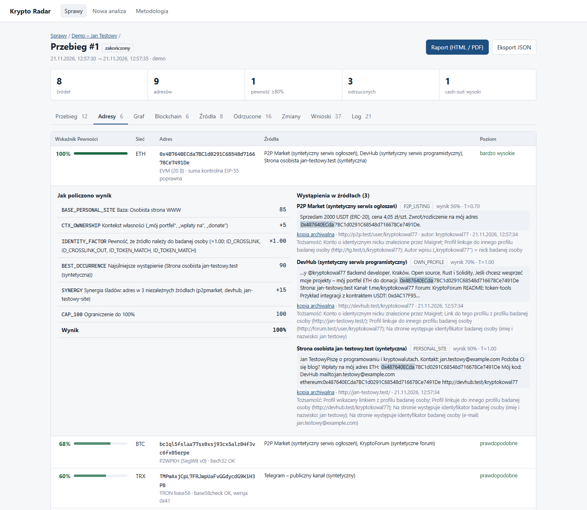

# Krypto Radar

**Materiały:** [opis projektu](docs/OPIS.md) · [prezentacja PDF](docs/Krypto-Radar-prezentacja.pdf) · [scenariusz filmu](docs/SCENARIUSZ-FILMU.md) · film: _link do uzupełnienia_



Narzędzie OSINT dla KAS: łączy publiczne ślady z internetu (nick, e-mail, imię i nazwisko, profil) z adresami kryptowalutowymi, liczy jawny Wskaźnik Pewności, odrzuca adresy giełd i kontraktów oraz wykrywa sygnały wymiany krypto na fiat.

## Jak działa

```
identyfikatory → Maigret (konta po nicku) + SearXNG (wyszukiwarka)
              → pobranie i archiwizacja stron (SHA-256, robots.txt, allowlist)
              → ocena, czy profil należy do osoby (T)
              → wykrycie adresów z walidacją sum kontrolnych (BTC, ETH, TRON, LTC)
              → weryfikacja: etykiety, bytecode, tagi eksploratora
              → analiza on-chain i wskaźniki cash-out
              → Wskaźnik Pewności → porównanie z poprzednim przebiegiem → raport
```

Tryby: **demo** (syntetyczne źródła i transakcje, offline) i **live** (prawdziwe źródła). Tryb wybiera się przy każdej sprawie.

## Wskaźnik Pewności

```
wystąpienie = clamp(baza + kontekst, 0, 100) × T
wynik       = min(100, max(wystąpienie) + 15 [≥2 niezależne źródła] + 10 [przepływ on-chain z adresem ≥80%])
giełda · kontrakt (bytecode ≠ 0x) · mikser · zbiórka · usługa → 0%
```

| Źródło | Baza |
|---|---|
| własny profil | 90 |
| strona osobista | 85 |
| ogłoszenie P2P | 70 |
| komunikator (rozliczenie), stopka e-mail | 65 |
| forum | 50 |
| giveaway / masowe komentarze | 20 |

Kontekst (zdanie z adresem): „mój portfel”, „wpłaty na” +5 · „sprzedam”, „cena” +5 · „adres giełdy”, „kontrakt”, „oszust” −25 · cytat −20.

**T – czy źródło należy do osoby:** URL od analityka 1.0 · link z profilu osoby ≤0.85 · ten sam nick 0.6 · wynik wyszukiwania 0.4 · imię/e-mail/komunikator na stronie +0.15 · link do innego profilu osoby +0.1 · pospolity nick −0.2 · inne imię i nazwisko na profilu −0.35.

Adresy z wątków przypisywane są tylko autorowi będącemu badaną osobą.

## Cash-out

`CEX_DEPOSIT` wpłata na giełdę · `OFFRAMP_GATEWAY` bramka / karta krypto · `P2P_SERVICE` escrow P2P · `STABLECOIN_SWAP` DEX → stablecoin · `MIXER` · `CEX_WITHDRAWAL` zakup na giełdzie · `HIGH_VOLUME`. Każdy wskaźnik wskazuje transakcje.

## Raport

HTML/PDF i JSON: adresy z rozpisaną punktacją, odrzucone przypisania z dowodem, przepływy w czasie, podział **FAKT / OBLICZENIE / WNIOSEK**, źródła (URL, czas, HTTP, SHA-256), wersje, parametry i dziennik zapytań.

## Architektura

| Katalog | Technologia |
|---|---|
| `apps/api` | Node.js 22, TypeScript, Fastify, PostgreSQL 16 |
| `apps/web` | React 18, Vite, nginx |
| `services/osint-worker` | Python, FastAPI, Maigret |
| `services/searxng` | SearXNG (wewnętrzna wyszukiwarka) |
| `services/mock-osint` | syntetyczne źródła (demo) |

Rozszerzanie: źródło → `apps/api/data/sources.json`, etykiety → `apps/api/data/labels/*.json`, sieć → klasa `ChainProvider`. AI opcjonalne przez API zgodne z OpenAI (`LLM_BASE_URL`, `LLM_MODEL`), tylko streszczenie – nie wpływa na wynik.

## Bezpieczeństwo

- Tylko źródła publiczne, bez logowania (Instagram, Facebook, X, LinkedIn pomijane), `robots.txt`, limit tempa.
- Ruch wychodzący API przez allowlistę; tryb `EGRESS_OPEN_WEB` dopuszcza strony publiczne, adresy prywatne i wewnętrzne są zawsze blokowane (SSRF), także po przekierowaniu.
- Baza, mock i Ollama w sieci Docker bez internetu. Panel tylko na `127.0.0.1`.
- Blockscout, mempool.space i SearXNG można hostować samodzielnie.

## Uruchomienie

```bash
cp .env.example .env
docker compose up -d --build
```

http://localhost:8080 → Nowa analiza → Demo → Wypełnij danymi demo → Uruchom.

Live: w `.env` ustaw `RADAR_LIVE_ENABLED=true`, `EGRESS_OPEN_WEB=true` i opcjonalnie `GITHUB_TOKEN`.

Serwer (Ubuntu): to samo, panel przez tunel `ssh -L 8080:127.0.0.1:8080 user@host` lub reverse proxy z TLS i logowaniem.

## Testy

```bash
npm install && npm test                            # 31 testów jednostkowych
node scripts/acceptance.mjs http://localhost:8080  # scenariusz end-to-end (scenarios/demo-kowal.json)
```

Wynik na serwerze:

```
✔ [A1] ETH: profil + strona + P2P → 100% (SYNERGY)
✔ [A2] BTC: P2P + forum → 68% (SYNERGY)
✔ [A3] TRON w rozliczeniu na Telegramie → 60%
✔ [A4] giveaway → 17%
✔ [A5] ten sam nick, inna osoba → 24% (ID_NAME_CONFLICT)
✔ [X1] Binance → 0% (EXCL_LABEL_EXCHANGE)
✔ [X2] kontrakt USDT → 0% (EXCL_LABEL_TOKEN)
✔ [X3] nieoznaczony kontrakt → 0% (EXCL_CONTRACT_BYTECODE)
✔ [X4] adres innego autora wątku → nieprzypisany
✔ [C1] CEX_DEPOSIT, OFFRAMP_GATEWAY, P2P_SERVICE, STABLECOIN_SWAP, CEX_WITHDRAWAL
✔ [C2] BTC → giełda: CEX_DEPOSIT
✔ [R2] literówka w adresie → odrzucona (EIP-55)
✔ [P1–P4] URL, czas, SHA-256, dziennik, wersje, FAKT/OBLICZENIE/WNIOSEK, raport
✔ [T1] podmiana adresu na profilu między przebiegami
✔ [T2] nowy adres: premia za przepływ on-chain → 80%
Wszystkie scenariusze zaliczone.
```

Zrzuty ekranu: [docs/screenshots](docs/screenshots).

Dane demo są fikcyjne: adresy generowane deterministycznie (`apps/api/scripts`), bez kluczy prywatnych. Adresy giełd i kontraktów w rejestrze etykiet są prawdziwe i publiczne.

## Licencje

MIT. Komponenty: [LICENSES.md](LICENSES.md).
